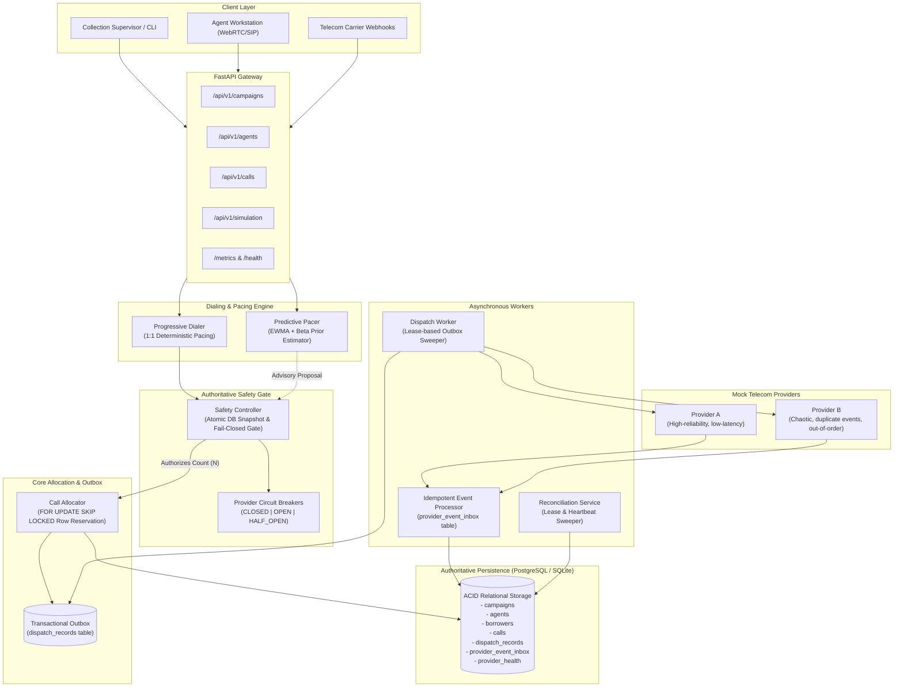
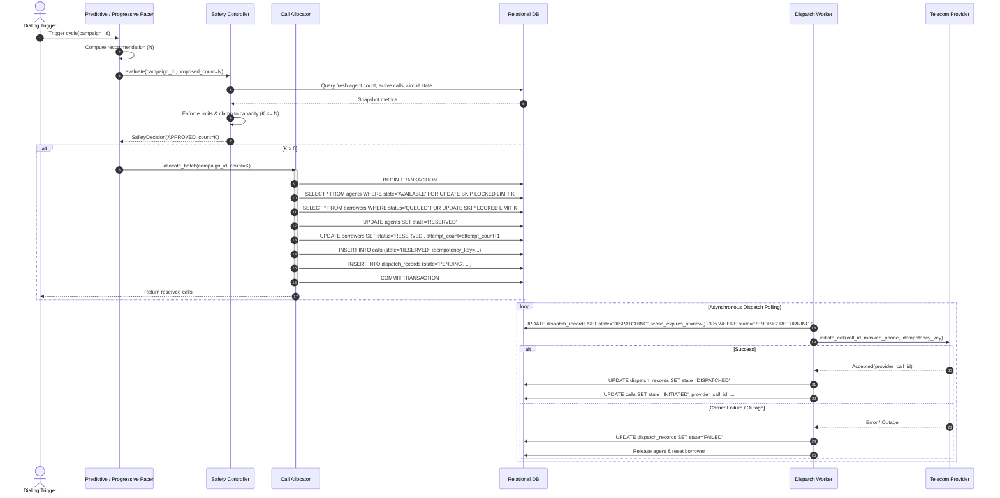
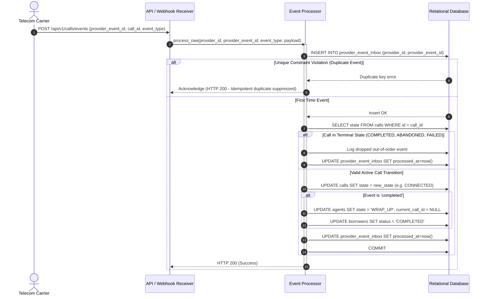

# SmartDialer System Architecture

SmartDialer is a production-grade, distributed outbound dialing platform built for high-throughput, compliant debt collections and customer contact centers. It provides deterministic Progressive dialing, dynamic Predictive pacing (powered by an EWMA answer-rate estimator), an authoritative independent Safety Controller, transactional outbox dispatching, and idempotent event processing.

---

## 1. High-Level Architecture Diagram



---

## 2. Core Architectural Components

### 2.1 API Layer (`app/api/`)
* **Framework**: FastAPI (async ASGI) with Pydantic v2 schemas and RFC 7807 problem details error handling.
* **Campaigns**: Start/pause campaigns, update parameters (concurrency limits, wrap-up duration, retry cooldowns), and trigger dialing cycles on demand.
* **Agents**: Register agents, handle state transitions (`AVAILABLE`, `PAUSED`, `OFFLINE`), receive heartbeats, and view current assignments.
* **Calls**: Query call records, inspect event audit trails, and trigger manual terminations.
* **Simulation & Metrics**: Trigger multi-scenario comparison runs and export Prometheus-compatible telemetry.

### 2.2 Pacing Engines (`app/services/`)
1. **Progressive Dialer (`ProgressiveDialer`)**:
   * Deterministic 1:1 pacing.
   * Inspects available agent count and requests exactly that many calls.
   * Guarantees zero abandonment under normal operating conditions.
2. **Predictive Pacing Engine (`PredictivePacingEngine`)**:
   * Purely advisory; calculates desired over-dial factor based on an EWMA answer-rate estimator with a Beta(2, 2) Bayesian prior.
   * Recommends calls according to:
     $$\text{Target} = \min\left(\left\lceil \frac{A_{\text{avail}}}{\hat{p}} \right\rceil - C_{\text{ringing}}, A_{\text{avail}} \times R_{\max}\right)$$
   * Downscales recommendations during provider degradation or when outstanding call volume threatens abandonment compliance.

### 2.3 Authoritative Safety Gate (`SafetyController`)
* **Strict Separation of Concerns**: The Predictive Pacer is never granted authority to initiate calls. It outputs an *advisory recommendation*.
* **Authoritative DB Re-read**: The safety gate executes a fresh database transaction immediately before allocation to verify:
  1. Campaign status is `ACTIVE`.
  2. Campaign active call concurrency limit is not breached.
  3. Real available agent capacity ($A_{\text{avail}} > 0$).
  4. Provider circuit breaker is healthy (`CLOSED` or `HALF_OPEN`).
* **Fail-Closed Semantics**: If the database is unreachable, a database query errors, or circuit breakers trip, the safety controller rejects the request (approved count = 0).

### 2.4 Atomic Call Allocator (`CallAllocator`)
* **Row-Level Concurrency Control**:
  * Employs PostgreSQL row-level locking (`FOR UPDATE SKIP LOCKED`) to atomically match available agents with the highest-priority eligible borrowers.
  * In SQLite test/simulation environments, uses atomic serialized transactions with exponential backoff contention retries.
* **Deterministic Idempotency Key**:
  * Every call allocation creates an idempotency key:
    $$\text{idempotency\_key} = \text{"alloc:"} + \text{campaign\_id} + \text{":"} + \text{borrower\_id} + \text{":"} + \text{attempt\_count}$$
  * A unique constraint on `calls.idempotency_key` guarantees that no two workers can dial the same borrower simultaneously, even under massive race conditions.
* **Atomicity**: The reservation of the agent, reservation of the borrower, creation of the `Call` entity, and insertion of the `DispatchRecord` in the transactional outbox occur in the exact same ACID database transaction.

### 2.5 Transactional Outbox & Dispatch Worker (`DispatchWorker`)
* **Zero Lost Dispatches**: Calls are never dispatched via raw network HTTP requests inside the allocation transaction. Instead, a `DispatchRecord` is inserted with state `PENDING`.
* **Lease-Based Processing**: The dispatch worker claims pending records using a short-lived lease (`lease_expires_at`). If a worker crashes mid-flight, another worker reclaims the lease once expired.
* **Carrier Resilience**: The worker invokes the selected telecom provider passing the call ID and idempotency key.

### 2.6 Idempotent Event Inbox (`EventProcessor`)
* **Deduplication Inbox**: Webhooks and provider events are first recorded in `provider_event_inbox (provider_id, provider_event_id)` with a unique constraint. Duplicate deliveries are recognized, logged, and acknowledged without re-processing.
* **Terminal State Protection**: Once a call reaches a terminal state (`COMPLETED`, `ABANDONED`, `FAILED`, `BUSY`, `NO_ANSWER`), out-of-order delayed events (e.g. late `ringing` or duplicate `answered`) are silently dropped, preventing corrupted agent or borrower states.

### 2.7 Reconciliation Service (`ReconciliationService`)
* Runs periodically (or on demand) to heal the system from unexpected node crashes or transient anomalies:
  * Releases agents stuck in `WRAP_UP` past the campaign wrap-up window.
  * Reclaims expired dispatch leases where the carrier never replied.
  * Transitions stale agents without heartbeats to `OFFLINE`.
  * Resolves ambiguous call states where carriers timed out.

---

## 3. Sequence Diagrams

### 3.1 Call Allocation & Transactional Outbox Dispatch



### 3.2 Inbound Webhook & Idempotent Event Processing



---

## 4. API Endpoints & `curl` Examples

### 4.1 Health & Metrics
```bash
# Check service and database health
curl -s http://localhost:8000/health | jq .

# Read real-time Prometheus metrics
curl -s http://localhost:8000/metrics
```

### 4.2 Campaign Management
```bash
# 1. Create a new campaign
curl -X POST http://localhost:8000/api/v1/campaigns \
  -H "Content-Type: application/json" \
  -d '{
    "name": "Mortgage Early Stage Collections",
    "dialing_mode": "predictive",
    "max_concurrent_calls": 30,
    "max_attempts_per_borrower": 3,
    "retry_cooldown_seconds": 1800,
    "wrap_up_seconds": 30
  }' | jq .

# 2. Trigger a manual dialing cycle for a campaign
curl -X POST http://localhost:8000/api/v1/campaigns/<CAMPAIGN_ID>/dial \
  -H "Content-Type: application/json" \
  -d '{"provider_id": "mock_provider_a"}' | jq .
```

### 4.3 Agent Management
```bash
# 1. Register a new agent
curl -X POST http://localhost:8000/api/v1/agents \
  -H "Content-Type: application/json" \
  -d '{
    "campaign_id": "<CAMPAIGN_ID>",
    "name": "Jane Doe",
    "state": "AVAILABLE"
  }' | jq .

# 2. Send heartbeat
curl -X POST http://localhost:8000/api/v1/agents/<AGENT_ID>/heartbeat | jq .

# 3. Transition agent state to PAUSED
curl -X POST http://localhost:8000/api/v1/agents/<AGENT_ID>/state \
  -H "Content-Type: application/json" \
  -d '{"new_state": "PAUSED"}' | jq .
```

### 4.4 Trigger Reconciliation
```bash
curl -X POST http://localhost:8000/api/v1/reconcile | jq .
```

---

## 5. Security & Invariant Guarantees

| Invariant | Implementation Mechanism | Enforcement Layer |
| :--- | :--- | :--- |
| **No Double Agent Assignment** | PostgreSQL `SELECT ... FOR UPDATE SKIP LOCKED` + state transition check `AVAILABLE -> RESERVED` + foreign key `agents.current_call_id`. | `CallAllocator` & DB row lock |
| **No Duplicate Borrower Calls** | Unique constraint on `calls.idempotency_key` (`alloc:{campaign}:{borrower}:{attempt}`) + row lock on eligible borrowers. | Relational Schema & `CallAllocator` |
| **Strict Concurrency Limits** | Fresh authoritative recount of active calls before evaluating requests; fails closed if active calls >= max. | `SafetyController` |
| **Advisory Pacing Only** | `PredictivePacingEngine` has no DB write access and cannot invoke telecom providers; calls only originate from `SafetyController` approval. | Architecture Boundary |
| **Idempotent Webhooks** | Unique constraint on `provider_event_inbox(provider_id, provider_event_id)` + terminal state transition guards. | `EventProcessor` |
| **Circuit Breakers** | Failure tracking across sliding window with automatic open/half-open tripping and provider fallback. | `ProviderHealthService` |
