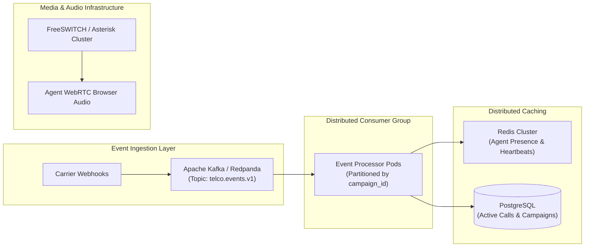

# SmartDialer Technical Evaluator Interview & Architecture Guide

This guide is designed for technical interviewers, system architects, and evaluators reviewing the SmartDialer codebase. It explains key engineering decisions, walks through interactive demonstrations, and addresses deep questions regarding concurrency, reliability, and production scalability.

---

## 1. Quickstart & Verification Commands

All commands can be executed directly from the repository root:

```powershell
# 1. Run the entire automated test suite (58 tests across unit, integration, concurrency, failure injection)
.\.venv\Scripts\pytest tests/ -v

# 2. Run the Progressive vs. Predictive simulation comparison
.\.venv\Scripts\python -u scripts/run_simulation.py --scenario low_answer_rate --mode both --agents 10 --borrowers 50

# 3. Run all 7 simulation scenarios
.\.venv\Scripts\python -u scripts/run_simulation.py --scenario all --mode both

# 4. Run the high-concurrency worker load test (5 parallel workers hammering the database)
.\.venv\Scripts\python -u scripts/run_load_test.py --workers 5 --agents 20 --borrowers 100 --duration 5

# 5. Seed the database with sample campaigns, agents, and synthetic borrowers
.\.venv\Scripts\python -u scripts/seed_demo.py --db-path smartdialer.db

# 6. Start the FastAPI development server and view Swagger UI (http://localhost:8000/docs)
.\.venv\Scripts\python -m uvicorn app.main:app --reload
```

---

## 2. Walkthrough: The 5 Core Engineering Highlights

### 1. Pure Separation of Concerns: Advisory Pacer vs. Authoritative Safety Gate
* **The Problem**: Predictive algorithms are stochastic; sudden anomalies in answer rates or estimation drift can cause massive over-dialing, risking severe regulatory penalties ($10,000+ fines per illegal call under TCPA / TSR 3% abandonment rules).
* **Our Solution**: The `PredictivePacingEngine` is **purely advisory**. It computes a recommendation based on EWMA answer rate and current queue depth. It has no write permissions. The `SafetyController` performs an atomic, authoritative re-read of true database capacity immediately prior to allocation. If database queries fail or capacity is exceeded, it **fails closed** (approving 0 calls).
* **Where to inspect**: [`app/services/predictive_pacer.py`](file:///c:/Github/CredResolve/app/services/predictive_pacer.py) and [`app/services/safety_controller.py`](file:///c:/Github/CredResolve/app/services/safety_controller.py).

### 2. Elimination of Race Conditions via `SKIP LOCKED` and Idempotency Keys
* **The Problem**: Multiple background workers dialing concurrently can select the same available agent or call the same borrower twice.
* **Our Solution**:
  * PostgreSQL `SELECT ... FOR UPDATE SKIP LOCKED` allows workers to grab mutually exclusive rows without blocking or deadlocking.
  * Every call generates a deterministic idempotency key: `alloc:{campaign_id}:{borrower_id}:{attempt_count}` backed by a database unique constraint.
* **Where to inspect**: [`app/services/call_allocator.py`](file:///c:/Github/CredResolve/app/services/call_allocator.py) and [`tests/concurrency/test_call_allocator_concurrency.py`](file:///c:/Github/CredResolve/tests/concurrency/test_call_allocator_concurrency.py).

### 3. Zero Lost Calls via Transactional Outbox
* **The Problem**: Making external HTTP network calls to telecom providers inside a database transaction causes connection pool exhaustion, and if the app crashes before committing, the call is orphaned.
* **Our Solution**: Allocator inserts a `DispatchRecord` with state `PENDING` into the transactional outbox table in the *same* ACID transaction as the call. The asynchronous `DispatchWorker` claims records via lease renewal and contacts the carrier outside the transaction.
* **Where to inspect**: [`app/workers/dispatch_worker.py`](file:///c:/Github/CredResolve/app/workers/dispatch_worker.py).

### 4. Durable Idempotent Event Inbox with Terminal State Protection
* **The Problem**: Telecom webhooks are frequently duplicated or delivered out-of-order over public networks.
* **Our Solution**:
  * Incoming webhooks insert into `provider_event_inbox` with unique index `(provider_id, provider_event_id)`. Duplicates are acknowledged without re-processing.
  * If a call has reached a terminal state (`COMPLETED`, `ABANDONED`, `FAILED`), out-of-order events (such as late `ringing`) are safely dropped.
* **Where to inspect**: [`app/services/event_processor.py`](file:///c:/Github/CredResolve/app/services/event_processor.py) and [`tests/failure_injection/test_event_duplicates.py`](file:///c:/Github/CredResolve/tests/failure_injection/test_event_duplicates.py).

### 5. Chaos-Ready Mock Providers & Self-Healing Reconciliation
* **The Problem**: Verifying carrier degradation, circuit tripping, and worker crashes requires deterministic test doubles.
* **Our Solution**:
  * `MockProviderA` models reliable carrier infrastructure.
  * `MockProviderB` simulates failure bursts, jitter, duplicate events, and out-of-order deliveries.
  * `ProviderHealthService` trips circuit breakers to `OPEN` when failure thresholds are crossed.
  * `ReconciliationService` periodically sweeps and heals stale agent states and expired dispatch leases.
* **Where to inspect**: [`app/providers/mock_provider_b.py`](file:///c:/Github/CredResolve/app/providers/mock_provider_b.py) and [`app/services/reconciliation.py`](file:///c:/Github/CredResolve/app/services/reconciliation.py).

---

## 3. Anticipated Interviewer Questions & Answers

### Q1: "Why did you choose `FOR UPDATE SKIP LOCKED` over a distributed lock like Redis Redlock?"
> **Answer**: In high-throughput transactional queuing, Redis distributed locks introduce multiple failure modes: clock drift, split-brain partitions, and separate failure domains. Furthermore, acquiring locks on candidate rows in Redis requires round-trips for every candidate ID, followed by a database transaction.
> 
> PostgreSQL's `FOR UPDATE SKIP LOCKED` handles row reservation directly inside the database query engine. Workers skip locked rows instantaneously with zero contention, zero deadlocks, and zero network round-trips. Furthermore, if a worker node crashes mid-transaction, PostgreSQL immediately rolls back the row lock, preventing orphaned locks.

### Q2: "How do you ensure you don't violate the 3% call abandonment limit?"
> **Answer**: Two distinct layers protect compliance:
> 1. **Confidence-damped EWMA estimator**: In [`app/services/predictive_pacer.py`](file:///c:/Github/CredResolve/app/services/predictive_pacer.py), answer-rate tracking begins with a conservative Beta(2, 2) prior and scales slowly. If talk times or answer rates vary wildly, the pacer reduces the over-dial ratio.
> 2. **Authoritative Ratio Clamp**: The `SafetyController` enforces a hard multiplier limit:
>    $$\text{Max Allowed} = A_{\text{avail}} \times R_{\max}$$
>    If available agent count $A_{\text{avail}} = 0$, the maximum approved calls is **strictly 0**, regardless of what the predictive pacer requested. In the simulation scenario `burst_answering` (where answer rate suddenly surges to 80%), this clamp keeps abandonment at 0.00%.

### Q3: "What happens if the telecom provider accepts a call, but your server crashes before saving the response?"
> **Answer**: This is solved by the Transactional Outbox. The call record and outbox record are committed to the database *before* any network request is made. The `DispatchWorker` claims the record with a 30-second lease (`lease_expires_at`).
> 
> If the worker crashes immediately after the carrier accepts the call:
> 1. The lease expires after 30 seconds.
> 2. The `ReconciliationService` reclaims the expired record and re-queues it for dispatch.
> 3. When the second worker contacts the carrier, it provides the deterministic `idempotency_key`. The carrier recognizes the key and returns the existing call ID rather than initiating a second physical call.

### Q4: "How does the system behave when switching between PostgreSQL and SQLite?"
> **Answer**: In production, PostgreSQL is the primary engine, utilizing native `FOR UPDATE SKIP LOCKED`. For local test suites, CI pipelines, and standalone simulations, SQLite (`aiosqlite`) is supported via our `_SessionProxy` pattern in [`app/persistence/database.py`](file:///c:/Github/CredResolve/app/persistence/database.py). The test suite automatically overrides the engine bindings and creates isolated disk-backed test databases per test, allowing 58 tests to execute in under 17 seconds without requiring an active Docker daemon.

---

## 4. Production Scalability Roadmap (10,000+ Concurrent Calls)

While this prototype is complete and fully runnable, scaling to tens of thousands of concurrent calls in an enterprise fintech environment would involve the following architectural evolutions:



1. **Kafka / Redpanda Event Ingestion**:
   * Replace direct webhook HTTP database writes with an Apache Kafka topic partitioned by `campaign_id`.
   * Guarantees strict sequential ordering of events per campaign and decouples webhook ingestion spikes from database write capacity.
2. **Redis In-Memory Agent Presence**:
   * Offload 10-second agent heartbeats from the relational database to Redis TTL keys (`SET agent:{id}:heartbeat EX 30`).
   * Read available agent pools directly from Redis sets, only persisting state transitions to PostgreSQL.
3. **Dedicated Telephony Media Servers (FreeSWITCH / Asterisk)**:
   * Terminate SIP trunking on clustered FreeSWITCH servers.
   * Establish WebRTC audio bridges with browser-based agent workstations, transferring audio within <200ms of borrower pick-up to eliminate acoustic delay.
4. **Read Replicas for Analytics & Reporting**:
   * Route heavy supervisor reporting, historical EWMA calibrations, and compliance export queries to read replicas.
