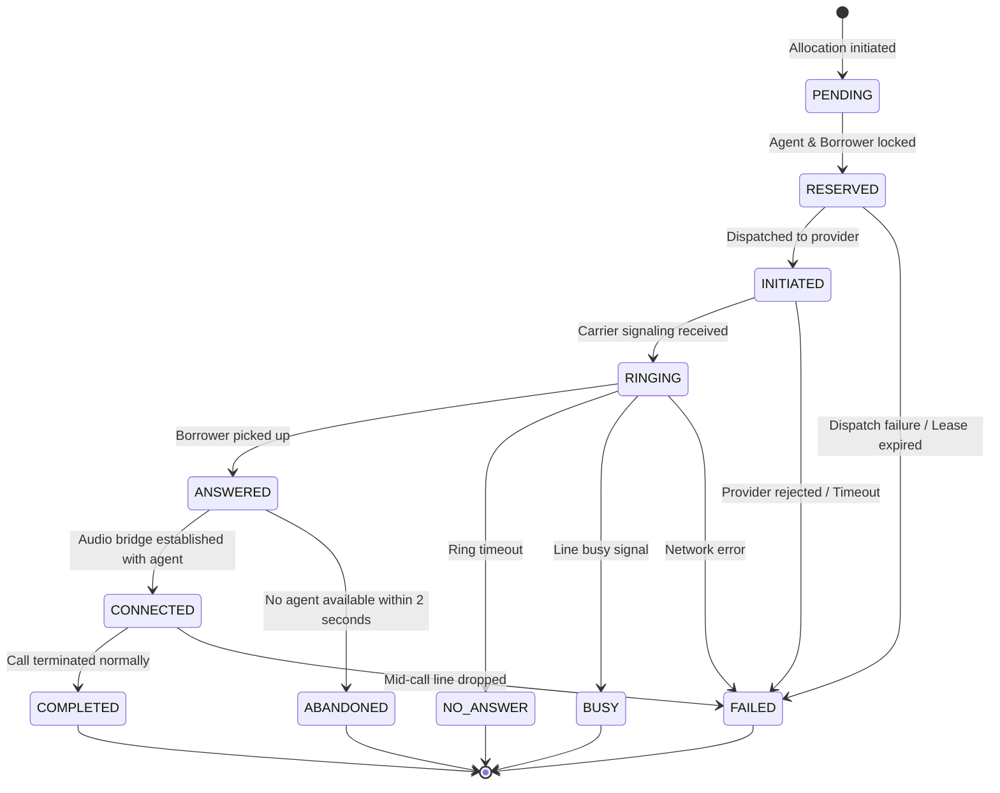
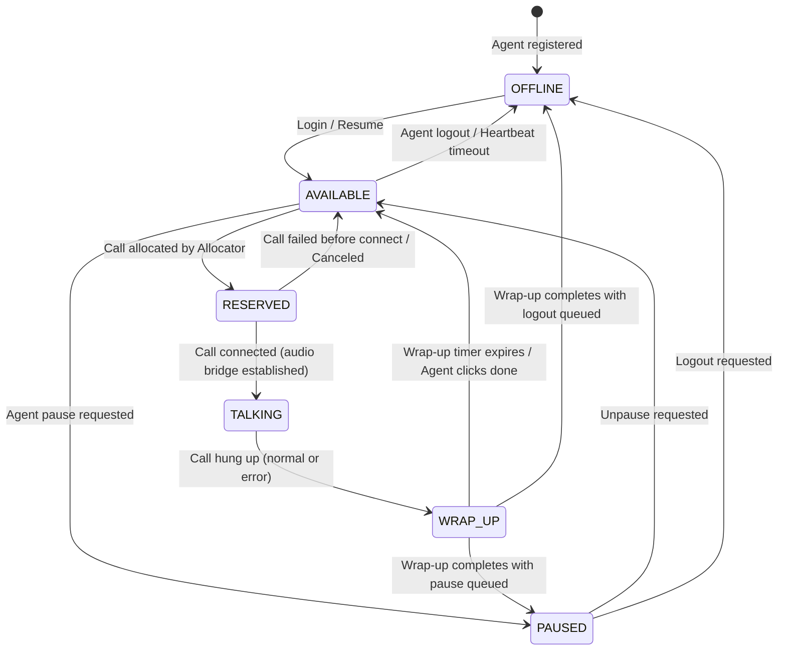
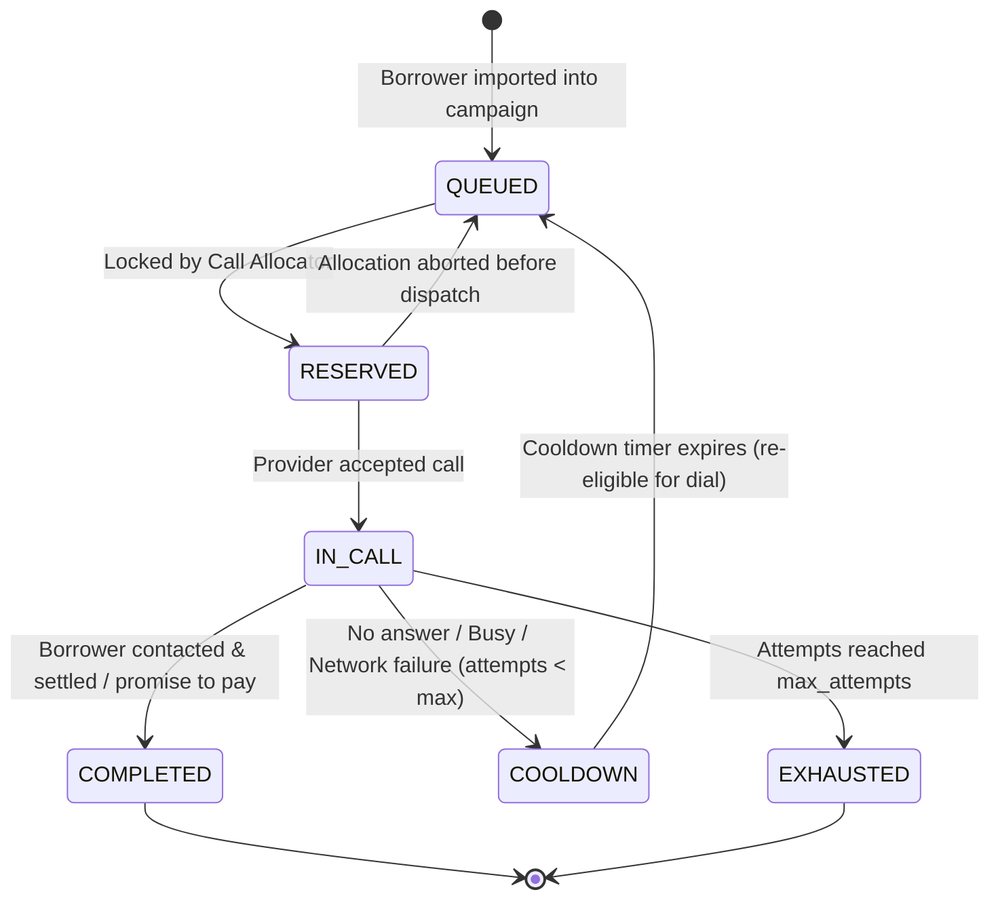
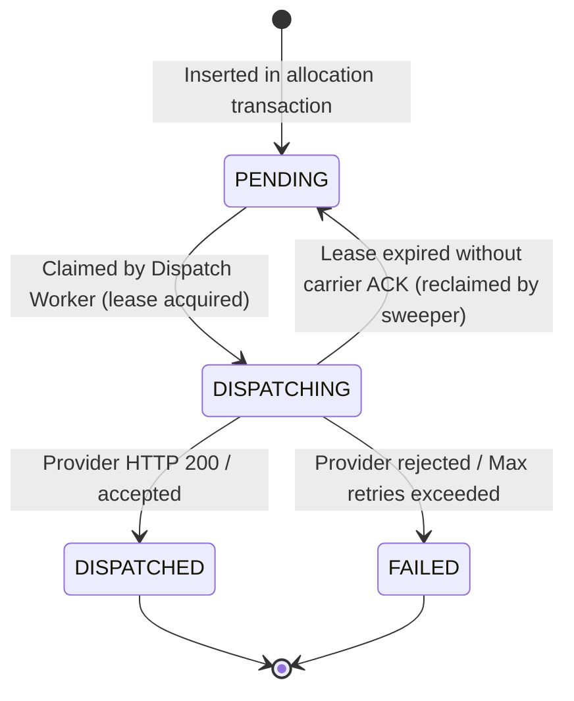
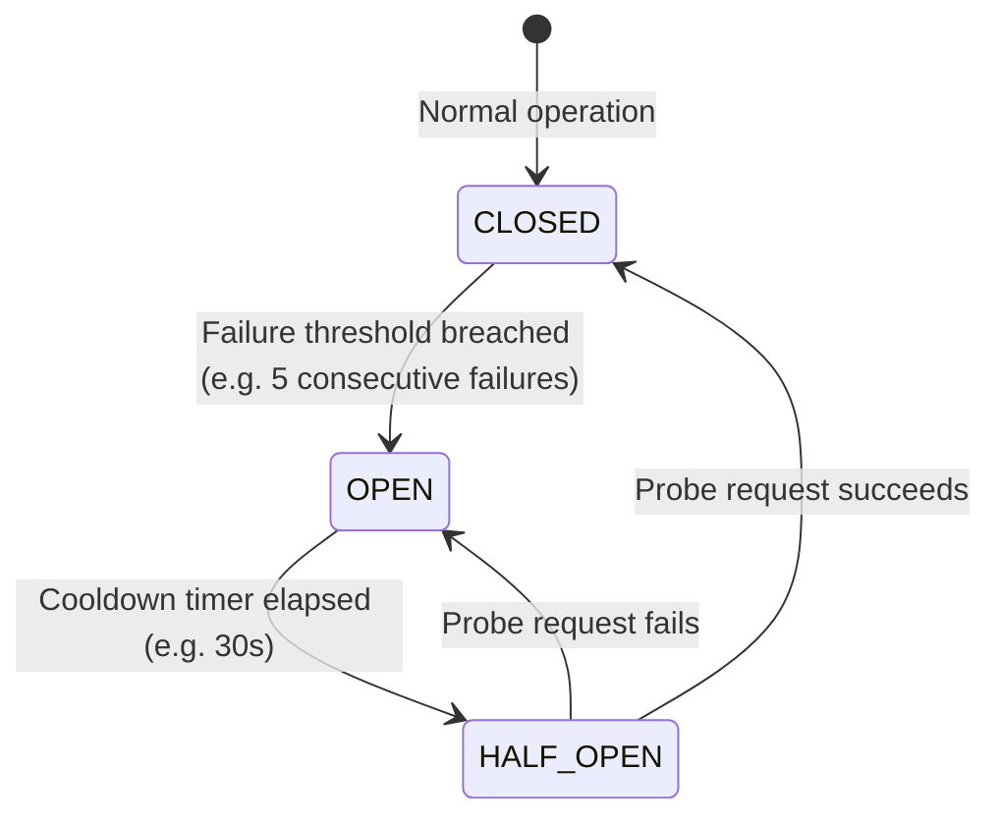

# SmartDialer State Machines & Lifecycle Transitions

State machines in SmartDialer are modeled as explicit, deterministic transitions enforced at both the application domain layer (`app/domain/state_machines.py`) and the persistence layer. Any invalid or illegal state transition raises a structured `InvalidStateTransitionError` and is prevented from corrupting database state.

---

## 1. Call State Machine

A call represents a specific attempt to connect an available agent with a queued borrower through a telecom carrier.

### 1.1 State Diagram

### 1.2 Call State Transitions Reference

| From State | To State | Trigger | Preconditions | Side Effects |
| :--- | :--- | :--- | :--- | :--- |
| `PENDING` | `RESERVED` | `CallAllocator.allocate()` | Agent and Borrower both locked | Sets `agent_id`, `borrower_id`, `idempotency_key` |
| `RESERVED` | `INITIATED` | Provider accepts call | Provider returned `provider_call_id` | Stores `provider_call_id`, updates `dispatch_records` |
| `RESERVED` | `FAILED` | Carrier rejects or timeout | Outbox failure | Frees reserved agent to `AVAILABLE`, releases borrower |
| `INITIATED` | `RINGING` | Carrier `ringing` webhook | Call is currently `INITIATED` | Updates `telemetry` |
| `INITIATED` | `FAILED` | Carrier error webhook | Call is currently `INITIATED` | Releases agent and reschedules borrower |
| `RINGING` | `ANSWERED` | Carrier `answered` webhook | Call is currently `RINGING` | Starts 2-second SLA timer to establish agent audio bridge |
| `RINGING` | `NO_ANSWER` | Carrier `no_answer` event | Borrower did not pick up | Releases agent; puts borrower into retry cooldown |
| `RINGING` | `BUSY` | Carrier `busy` event | Number busy | Releases agent; puts borrower into retry cooldown |
| `RINGING` | `FAILED` | Carrier disconnect | Network drop | Releases agent; checks retry eligibility |
| `ANSWERED` | `CONNECTED` | Audio bridge established | Agent is reserved and ready | Agent moves to `TALKING`, `connected_at` timestamp set |
| `ANSWERED` | `ABANDONED` | SLA breached (>2s no agent) | No agent available to bridge | Invariant tracked: `calls_abandoned += 1`, borrower freed |
| `CONNECTED` | `COMPLETED` | Either party hangs up | Call was in conversation | Agent moves to `WRAP_UP`; borrower status marked `COMPLETED` |
| `CONNECTED` | `FAILED` | Abrupt network disconnect | Call in conversation | Agent moves to `WRAP_UP`; sets error code |

### 1.3 Terminal State Rule
* **States**: `COMPLETED`, `ABANDONED`, `FAILED`, `BUSY`, `NO_ANSWER`.
* **Invariant**: Once a call enters a terminal state, **no further transitions are allowed**. Any incoming delayed webhooks (e.g., an out-of-order `ringing` or delayed `answered` event arriving after `completed`) are dropped and flagged as stale by `EventProcessor`.

---

## 2. Agent State Machine

The Agent state machine models human collectors ready to receive calls.

### 2.1 State Diagram

### 2.2 Agent State Transitions Reference

| From State | To State | Trigger | Description |
| :--- | :--- | :--- | :--- |
| `OFFLINE` | `AVAILABLE` | Agent Login API | Agent enters the pool and is eligible for call allocation. |
| `AVAILABLE` | `RESERVED` | Allocator locks agent | Agent is matched with a borrower and waiting for carrier connection. |
| `AVAILABLE` | `PAUSED` | Agent UI "Pause" | Agent takes a break. Excluded from dialing capacity calculations. |
| `AVAILABLE` | `OFFLINE` | Logout / Heartbeat missing | Agent logs out or missed 3 consecutive heartbeat cycles. |
| `RESERVED` | `TALKING` | Call `CONNECTED` | Agent is connected to the borrower and talking. |
| `RESERVED` | `AVAILABLE` | Call canceled / failed | Carrier failed to ring or answer; agent immediately returns to pool. |
| `TALKING` | `WRAP_UP` | Call `COMPLETED` | Call ends; agent enters post-call notes / disposition period. |
| `WRAP_UP` | `AVAILABLE` | Wrap-up timeout / Done | Wrap-up duration expires (reconciliation automatically cleans up). |
| `PAUSED` | `AVAILABLE` | Agent UI "Resume" | Agent returns from break. |

---

## 3. Borrower State Machine

Borrowers represent delinquent accounts scheduled for contact under regulatory limits.

### 3.1 State Diagram

### 3.2 Borrower State Invariants
* **Max Attempts**: Borrower cannot exceed `campaign.max_attempts_per_borrower` (default: 3). Once reached, borrower transitions to `EXHAUSTED` and will never be selected by `CallAllocator`.
* **Cooldown Period**: Unsuccessful attempts enter `COOLDOWN` with `next_attempt_after = now() + campaign.retry_cooldown_seconds`. `CallAllocator` filters for `status='QUEUED'` AND `next_attempt_after <= now()`.
* **Contact Success**: Once a borrower call is successfully completed (`status='COMPLETED'`), the borrower account is closed for the active campaign.

---

## 4. Transactional Outbox State Machine (`dispatch_records`)

The outbox guarantees zero loss of external call initiations across process crashes.

### 4.1 State Diagram

### 4.2 Outbox Invariants
* **Lease Expiration**: When a worker claims a record, it sets `lease_expires_at = now() + 30s`. If the worker crashes, the `ReconciliationService` resets expired records to `PENDING` with incremented retry count.
* **Deterministic Deduplication**: The outbox record includes `idempotency_key` which is sent to the telecom provider. Re-dispatches do not cause duplicate dials at the telecom carrier.

---

## 5. Circuit Breaker State Machine (`provider_health`)

Protects the dialing engine against carrier degradation, high failure rates, and upstream outages.

### 5.1 State Diagram

### 5.2 Circuit Breaker Rules
* **CLOSED**: Normal state. All call allocation requests for this provider are evaluated normally by `SafetyController`.
* **OPEN**: Carrier is failing. `SafetyController` immediately rejects all dialing requests targeting this provider (`approved_count = 0`), protecting borrower accounts and agent capacity.
* **HALF_OPEN**: Allows a single test request through. If successful, state resets to `CLOSED`; if unsuccessful, immediately re-trips to `OPEN`.
