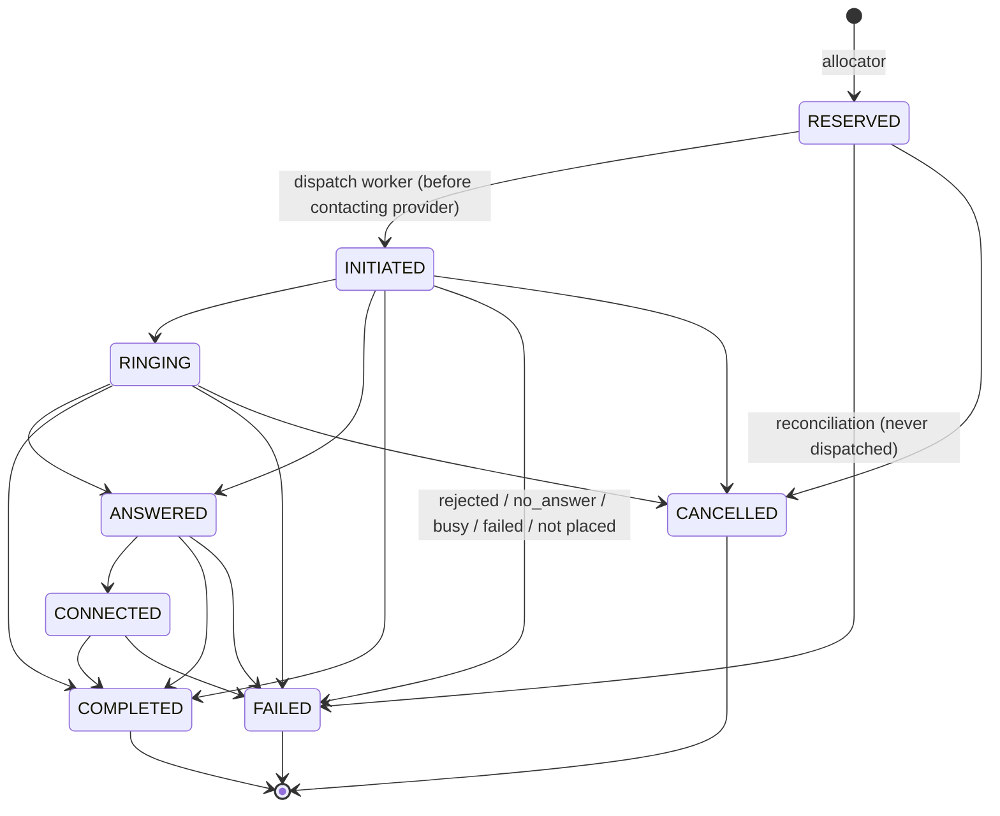
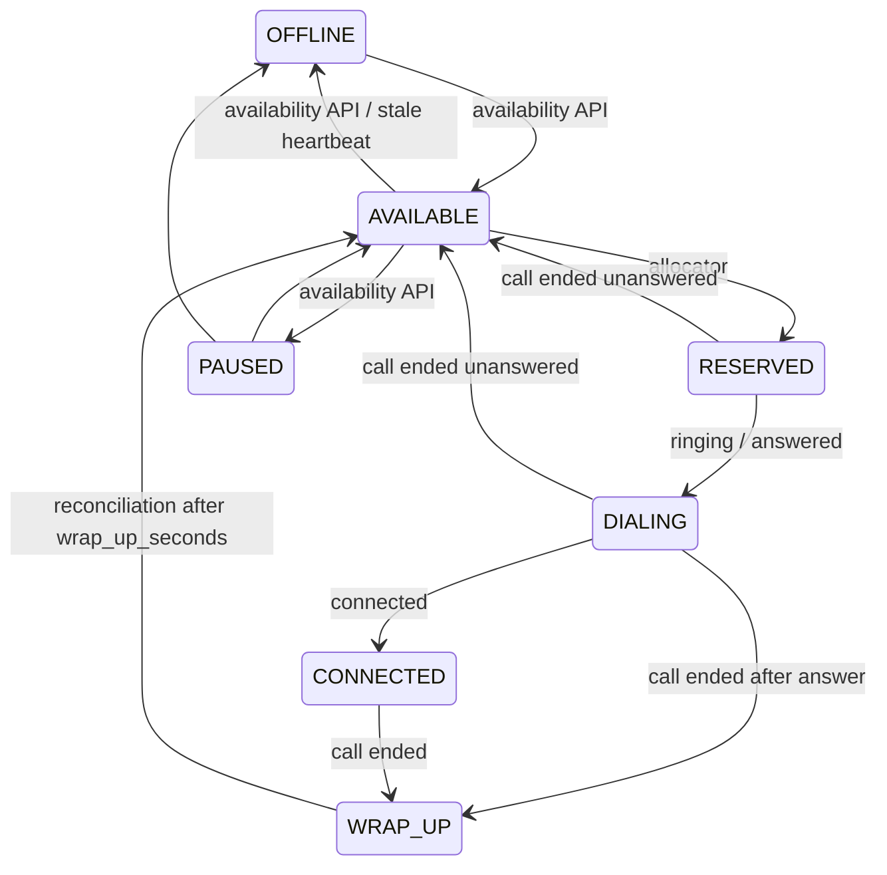

# State Machines

Allowed transitions are defined in `app/core/enums.py` (`VALID_CALL_TRANSITIONS`,
`VALID_AGENT_TRANSITIONS`) and enforced by conditional (compare-and-set)
updates. Final outcomes for call, agent and borrower are applied in one place:
`app/services/call_outcomes.py`.

## Call

Terminal states: `COMPLETED`, `FAILED`, `CANCELLED`. (`QUEUED` exists in the
enum but no code path creates calls in it.) There is no `ABANDONED`, `BUSY` or
`NO_ANSWER` call state: `busy`, `no_answer` and `failed` events all end the
call as `FAILED` with `failure_reason` set to the event type.

Event handling (`EventProcessor`):

| Situation | Behaviour |
|---|---|
| Duplicate event (same `provider_id` + `provider_event_id`) | Ignored (unique inbox row). |
| `initiated` event | Informational; the worker already set `INITIATED`. |
| Skip-ahead (`connected` while `RINGING`) | Applied through the implied steps (`ANSWERED` → `CONNECTED`). |
| Regressive (`ringing` while `CONNECTED`) | Recorded as stale, no state change. |
| Any event on a terminal call | No state change; a late `answered`/`connected` only fills the missing timestamp. |
| Event before `provider_call_id` is stored | Kept `PENDING` in the inbox and retried by the maintenance loop for `UNMATCHED_EVENT_MAX_AGE_SECONDS`. |

`is_ambiguous` is a flag, not a state: set when the dispatch outcome is unknown
(timeout, worker died after `SENT`), cleared when reconciliation learns whether
the provider accepted the idempotency key.

## Agent

* An agent is reserved only from `AVAILABLE` (and not `is_paused`).
* `RESERVED`, `DIALING`, `CONNECTED` and `WRAP_UP` cannot be changed through
  the availability API (400): an agent cannot leave in the middle of a call.
* The agent is moved for a call only while `agent.current_call_id` is that
  call, so a late event for an old call never touches the agent's next call.
* Stale heartbeat with an active call: the agent is kept (not taken offline).

## Borrower

| From | Event | To |
|---|---|---|
| `QUEUED` (eligible: not DNC, `next_eligible_at` passed) | allocated | `ALLOCATED`, `attempt_count + 1` |
| `ALLOCATED` | call answered / completed | `COMPLETED` |
| `ALLOCATED` | not reached, attempts < limit | `QUEUED`, `next_eligible_at = now + retry_cooldown_seconds` |
| `ALLOCATED` | not reached, attempts ≥ limit | `EXHAUSTED` |

The attempt limit is `min(borrower.max_attempts, campaign.max_attempts_per_borrower)`.
Settling is conditional on `ALLOCATED`, so a borrower is settled exactly once
per call even when reconciliation and an event race.

## Dispatch record (outbox)

`PENDING` → `CLAIMED` (lease) → `SENT` (committed before the provider call) →
`SUCCEEDED` | `FAILED` | `AMBIGUOUS`.

Only `CLAIMED` records with an expired lease are re-claimed — they provably
never reached the provider. A `SENT` record whose lease expired is marked
`AMBIGUOUS` and resolved by reconciliation, never re-sent.

## Circuit breaker (per provider)

`CLOSED` → `OPEN` after `circuit_breaker_failure_threshold` consecutive
failures → `HALF_OPEN` after `circuit_breaker_cooldown_seconds` → `CLOSED` after
`circuit_breaker_half_open_probes` successes, or back to `OPEN` on any failure.
OPEN: the Safety Controller rejects and the pacer proposes 0. HALF_OPEN: at
most the probe count is approved.
